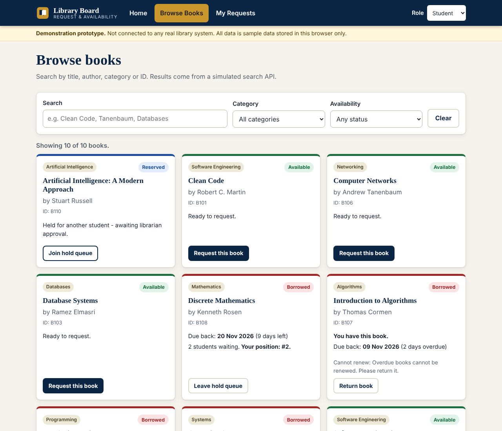
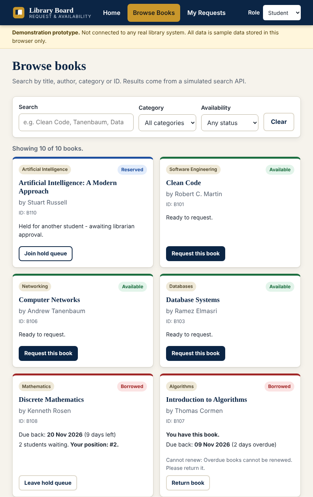
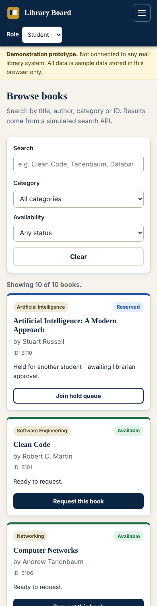

# Library Request & Availability Board

**Assignment 1 - Client-side web application** (CLO 1, 2, 4)
**Assigned idea:** #14 - Library Request and Availability Board
**Assigned rule:** Add catalog search, hold queue, due dates, renewals and librarian processing. *Avoid claiming real library integration.*
**Concepts:** Search APIs, queue logic, CRUD, authorization, data modeling, HTTP and asynchronous interfaces.

> **Demonstration prototype.** Not connected to any real library system. All books, users and requests are invented sample data stored in the browser only.

Built with **semantic HTML, CSS and vanilla JavaScript only** - no frameworks, libraries, CSS framework or template.

## What it does

Students can search the catalogue, see whether a book is **available, borrowed or reserved**, **request** available books, **join a FIFO hold queue** for unavailable ones (with queue position), see **due dates**, and **renew** eligible loans. A **librarian** can approve/reject pending requests (with a required reason when rejecting) and add, edit and delete catalogue records.

| Section | Contents |
|---|---|
| Navbar | Home, Browse Books, My Requests (student), Librarian (librarian) + role switch |
| Home / Dashboard | Totals, availability bar, pending requests, HTTP explanation and live request log |
| Browse Books | Search (title/author/category/ID), category + availability filters, book cards |
| My Requests | Request form, student details form, borrowed books + due dates, hold queues, request history |
| Librarian | Pending requests (approve/reject), processed list, add/edit/delete books |

## Setup / how to run

No install or build step is needed.

**Option 1:**
Live Application on Vercel: **https://library-request-availability-board.vercel.app/**

**Option 2:**
1. Download or clone the repository.
2. Open **`index.html`** in a modern browser (Chrome, Edge, Firefox, Safari) - double-click it.
3. *(Optional)* serve it locally: `python3 -m http.server 8000` then open <http://localhost:8000>.
4. *(Optional)* serve it locally: Use `npx serve` instead (needs Node.js) then open <http://localhost:3000>.
5. *(Optional)* GitHub Pages: repository **Settings -> Pages -> Deploy from branch -> main / root**.

Use the **Role** dropdown (top right) to switch between Student and Librarian. The footer button **Reset sample data** restores the original records.

## Try these workflows

1. **Search:** Browse Books -> type `tanenbaum`, or filter *Availability = Available*. Try a nonsense word to see the empty state.
2. **Request:** click **Request this book** on *Clean Code* -> it becomes *Reserved for you*.
3. **Queue:** click **Join hold queue** on *JavaScript Basics* -> you are position #2.
4. **Renew:** My Requests -> *Operating Systems* -> **Renew +7 days**. *Introduction to Algorithms* is overdue and cannot be renewed.
5. **Librarian:** switch Role to *Librarian* -> Librarian -> **Approve** or **Reject** (reason required).
6. **FIFO:** as Student, return a book that has a queue - the first student in the queue automatically gets a pending request.
7. **Validation:** submit the request form empty; enter `bad id` as Student ID; type `<` in the search box.

## Requirements checklist

- [x] Responsive navigation bar (hamburger on mobile)
- [x] Dashboard with book statistics
- [x] Ten sample books (6+ required) and sample users/requests
- [x] Search by title, author, category
- [x] Filter by availability and category
- [x] Request an available book
- [x] Join a waiting queue (FIFO) with position
- [x] Display due dates
- [x] Renew eligible books (date calculation)
- [x] Librarian approve/reject
- [x] Form validation and error messages
- [x] README, wireframe and design note (`docs/`)

## Project structure

```
index.html           Semantic page structure and forms
css/styles.css       Variables, Flexbox, Grid, 2+ media-query breakpoints
js/app.js            Data model, simulated server, queue logic, rendering, events
docs/design-note.md  User/problem, WDLC, client vs server, data model, rules
docs/wireframe.svg   Desktop and mobile wireframe
screenshots/         Desktop, tablet and mobile screenshots
```

## Screenshots

| Desktop | Tablet | Mobile |
|---|---|---|
|  |  |  |

More: `screenshots/desktop-home.png`, `screenshots/mobile-home.png`, `screenshots/desktop-requests.png`, `screenshots/mobile-requests.png`.

## JavaScript concepts demonstrated

| Feature | Concept |
|---|---|
| Search | `Array.filter`, `every/some`, `URLSearchParams`, debounce |
| Search API / async | `Promise` + `setTimeout` in `callApi()`, loading state, stale-response guard |
| Queue | FIFO with `push` / `shift` |
| Renewals | `Date` calculations, eligibility conditions |
| Librarian processing | CRUD on arrays of objects |
| Authorization | Role switch + `requireRole()` returning 403 (simulated only) |
| Dashboard / UI | DOM creation via `h()` helper (uses `textContent`, never `innerHTML`) |
| Persistence | `localStorage` with `try/catch` |

## Limitations (honest scope)

- No backend: data lives in the browser (`localStorage`), so it is per-device.
- Role switching is **not real security**; a server must enforce authorization in a later assignment.
- No real library integration is implied or claimed.

## AI Assistance and Attribution

AI tools (Claude by Anthropic) were used to assist with code generation, debugging. The project author reviewed the implementation, tested the application and prepared assignment documentation.

No third-party templates, frameworks, libraries, images, or fonts were used. All icons are created using hand-written inline SVG. Book titles and author names are used as sample catalogue data for demonstration purposes only.

## Testing Summary

The application was tested across its main features and different screen sizes to verify functionality, usability, and input handling.

**Functional testing included:**
- Book catalog search by title, author, category, and ID.
- Availability and category filtering.
- Empty search results and invalid input handling.
- Book request submission and hold queue joining/leaving.
- FIFO queue processing and automatic request promotion.
- Book renewal eligibility, due-date updates, and overdue restrictions.
- Librarian approval and rejection of requests.
- Adding, editing, and deleting catalogue records.
- Preventing deletion when a book has active dependencies.
- Role-based interface restrictions.
- Keyboard navigation and basic accessibility checks.

**Responsive testing:** The application was checked at approximately 390px (mobile), 820px (tablet), and 1280px (desktop) screen widths to verify that the layout adapts appropriately across devices.

**Testing environment:** Modern desktop and mobile browsers.
